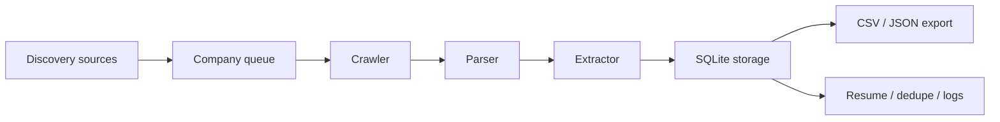
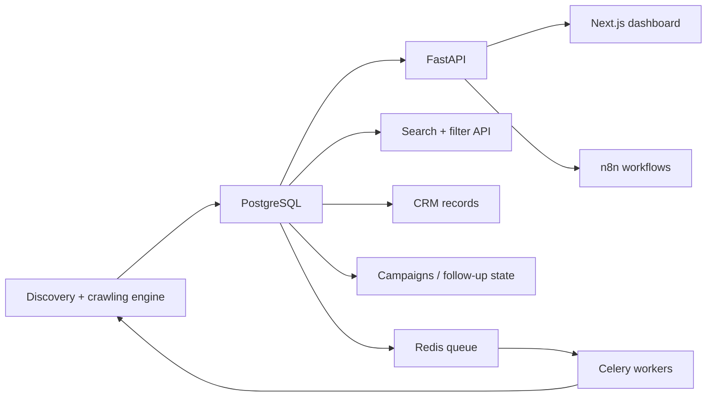

# Hybrid Apollo-Style Architecture

This repository now follows a hybrid design:

- the existing Python lead-generation pipeline remains the ingestion engine
- an Apollo-style platform layer sits on top for API, CRM, search, scoring, and automation

The goal is to keep the working discovery/crawl/extract flow, while evolving it
into a self-hosted B2B lead platform that can eventually serve teams from an API
and UI instead of only a command-line job.

## Current flow

Current sources include:

- Y Combinator startup directory
- UK Companies House
- seed CSVs

## Apollo-style platform layer

This top layer adds:

- searchable company and contact records
- lead lifecycle fields like status, tags, notes, campaign, and next contact
- API endpoints for search, crawl, verify, export, and campaign operations
- background job processing with Redis + Celery
- automation triggers through n8n
- a Next.js dashboard for review and reporting

## How the current system maps into the new platform

| Current module | Apollo-style role |
| --- | --- |
| `discovery.py` | Company discovery service |
| `crawler.py` | Website ingestion worker |
| `parser.py` | HTML normalization layer |
| `extractor.py` | Public-contact extraction / enrichment |
| `database.py` | Local persistence layer now, PostgreSQL later |
| `exporter.py` | Reporting and export service |
| `apollo/` | Transition layer for ranking, ICP logic, and future CRM scoring |
| `main.py` | Orchestrator / batch runner |

## Alternations being made

1. Keep the current startup/public-web lead engine working.
2. Add broader business discovery for fintech, finance, and healthcare.
3. Promote the database model from lead export to CRM-style records.
4. Expose the engine through REST APIs.
5. Move heavy crawl/enrichment work to workers.
6. Add campaign state and follow-up tracking.
7. Add dashboard and workflow automation around the core engine.

## Practical near-term target

The immediate target remains lead generation:

- discover real businesses from public sources
- collect public company and contact data
- extract decision-makers
- export qualified leads

After that, the same data model becomes the foundation for:

- CRM views
- filtering/search
- outreach workflows
- campaign tracking

